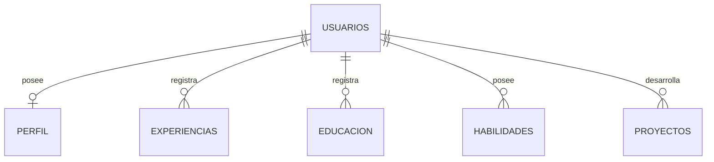

# Modelo relacional de Portfolio.

## Entidades:

USUARIOS
- PK: id
- username (UNIQUE)
- password_hash

PERFIL
- PK: id
- FK: usuario_id (UNIQUE)
- nombre
- titulo
- descripcion
- ubicacion
- email
- github
- linkedin
- foto
- banner

EXPERIENCIAS
- PK: id
- FK: usuario_id
- puesto
- empresa
- periodo
- descripcion
- imagen

EDUCACION
- PK: id
- FK: usuario_id
- titulo
- institucion
- periodo
- descripcion
- imagen

HABILIDADES
- PK: id
- FK: usuario_id
- nombre
- tipo
- porcentaje

PROYECTOS
- PK: id
- FK: usuario_id
- nombre
- fecha
- descripcion
- enlace
- imagen

## Relaciones

- Usuarios - Perfil: 1 a 1.
- Usuarios - Experiencias: 1 a N.
- Usuarios - Educacion: 1 a N.
- Usuarios - Habilidades: 1 a N.
- Usuarios - Proyectos: 1 a N.

## Restricciones

- Los nombres de usuario son unicos.
- Las contraseñas se almacenan mediante hash.
- Cada usuario puede tener como maximo un perfil.
- Los porcentajes deben estar entre 0 y 100.
- Las claves foraneas deben referenciar usuarios existentes.

## Diagrama entidad-relacion

